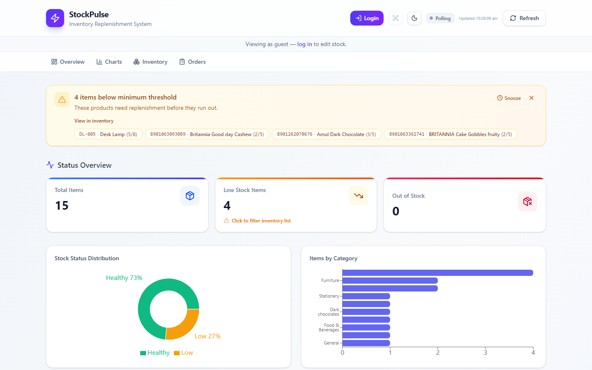
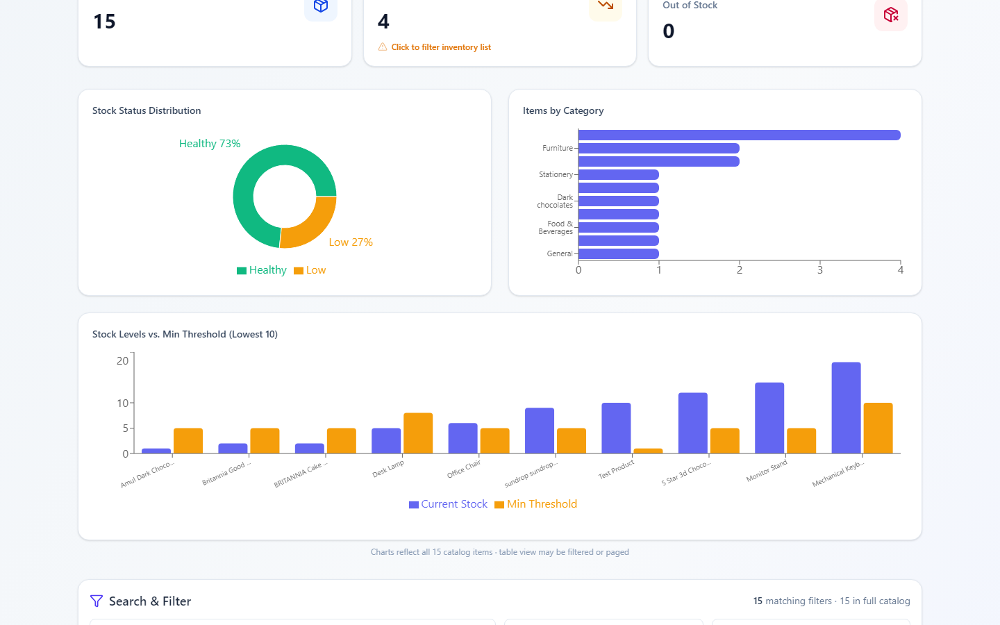
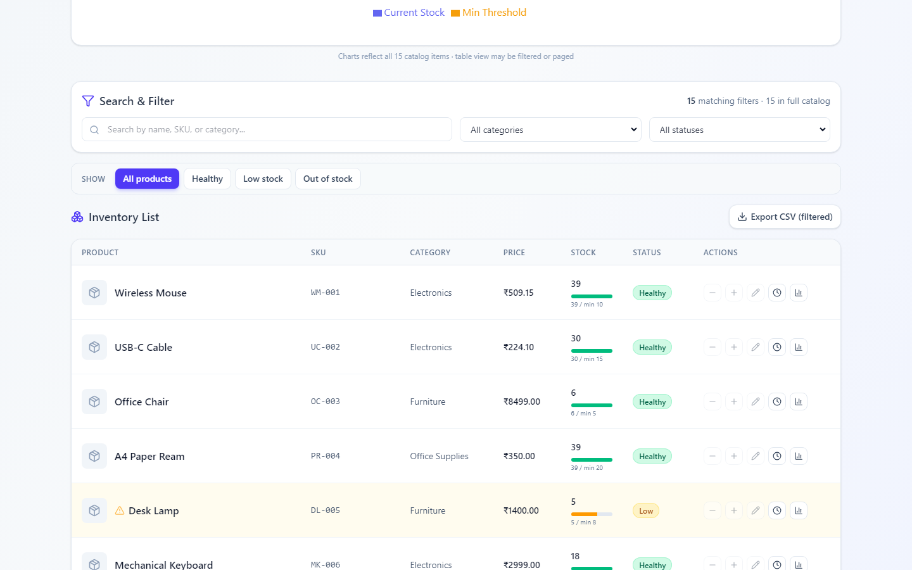
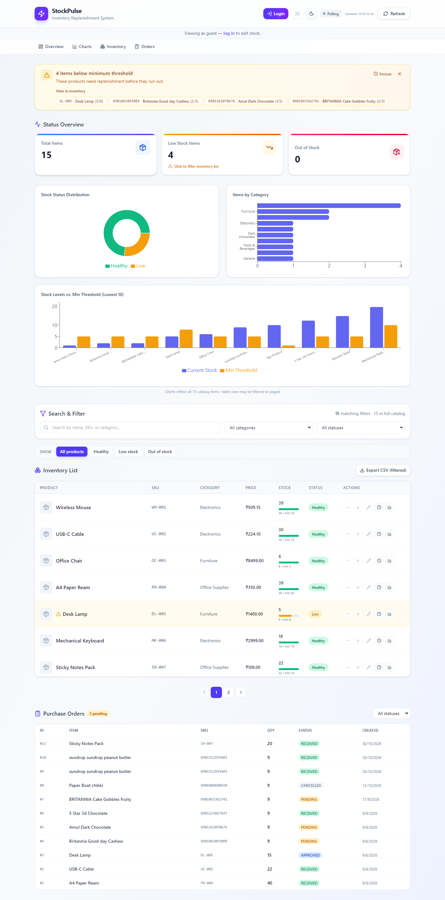
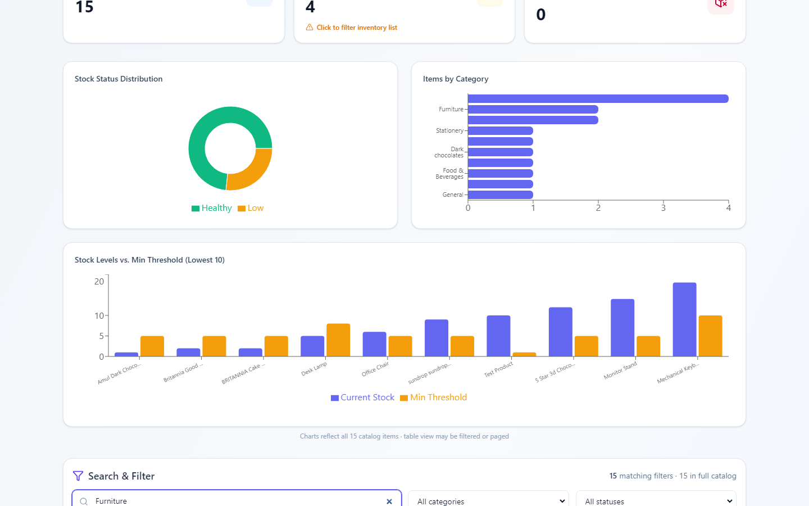

# StockPulse

Warehouse **inventory replenishment dashboard** with real-time stock updates, low-stock alerts, forecasts, purchase orders, and Google sign-in for editors.  
**Spring Boot** API · **React (Vite)** UI · deployed on **Render + Vercel**.

[](https://smart-replenish-warehouse-dashboard.vercel.app)

## Preview



| Charts & analytics | Inventory list & filters |
|--------------------|---------------------------|
|  |  |

<details>
<summary>More screenshots (full page, search, inventory table)</summary>



| Inventory table | Search filter |
|-----------------|---------------|
|  |  |

</details>

## Features

### Dashboard & inventory
- **Status overview** — total / low / out-of-stock counts; click cards to filter the table
- **Low-stock banners** — dismiss or snooze; jump to inventory, POs, or forecast
- **Charts** — status distribution, category breakdown, stock vs threshold
- **Search & filters** — debounced search, category/status dropdowns, removable chips, quick **All products** tabs
- **Paginated inventory table** — thumbnails, stock level bars, mobile card layout
- **Stock actions** — ±1, ±5, set stock, bulk update, CSV export (filtered or full catalog)
- **Guest mode** — browse read-only; **Login** for Google OAuth (ADMIN / MANAGER / VIEWER)

### Operations
- **Purchase orders**, **warehouses**, **suppliers** (editor roles)
- **Audit history** (paginated drawer), **demand forecast** per item
- **Barcode scanner** (logged-in editors)
- **Command palette** — `Ctrl+K` / `Cmd+K` to find SKUs and jump to rows

### Real-time
- **Live** badge when STOMP over **SockJS** is connected (`/ws` on the API)
- **Polling** fallback every 30s if the socket is down (e.g. API waking on free tier)

## Tech stack

| Layer | Technology |
|-------|------------|
| Backend | Java 21, Spring Boot 3.x, Spring Data JPA, WebSocket/STOMP, H2 / PostgreSQL |
| Frontend | React 19, TypeScript, Vite, Tailwind CSS, Recharts, `@stomp/stompjs`, SockJS |
| Auth | Google Sign-In + server-issued session token |
| Hosting | [Vercel](https://vercel.com) (frontend) · [Render](https://render.com) (API) |

## Project structure

```
stockpulse-inventory/
├── backend/                 # Spring Boot API
├── frontend/                # React dashboard
├── docs/screenshots/        # README & demo images
├── scripts/
│   └── capture-screenshots.mjs
├── render.yaml
└── README.md
```

## Run locally

### Backend

```bash
cd backend
./gradlew bootRun          # Linux/macOS
gradlew.bat bootRun        # Windows
```

- API base: `http://localhost:8080/api/inventory`
- WebSocket (SockJS): `http://localhost:8080/ws`

### Frontend

```bash
cd frontend
npm install
npm run dev
```

- UI: `http://localhost:5173`
- Set `VITE_API_BASE_URL=http://localhost:8080/api/inventory` in `frontend/.env` if needed

## Environment variables

### Frontend (Vercel)

| Variable | Example |
|----------|---------|
| `VITE_API_BASE_URL` | `https://YOUR-API.onrender.com/api/inventory` |
| `VITE_GOOGLE_CLIENT_ID` | Google OAuth client ID |
| `VITE_CLOUDINARY_*` | Optional image uploads |

Optional (defaults are fine for most setups):

| Variable | Purpose |
|----------|---------|
| `VITE_API_ORIGIN` | API origin for SockJS (`https://YOUR-API.onrender.com`) |
| `VITE_SOCKJS_URL` | Override STOMP SockJS URL |
| `VITE_WS_NATIVE` | `true` only if using native `/stomp` endpoint |

**Do not** set `VITE_WS_URL` to `/ws/websocket` unless you use native WebSockets.

### Backend (Render)

Activate the **`prod`** profile (`SPRING_PROFILES_ACTIVE=prod`). Production DB settings live in `backend/src/main/resources/application-prod.properties` (PostgreSQL / Neon — not H2).

| Variable | Purpose |
|----------|---------|
| `SPRING_PROFILES_ACTIVE` | Set to `prod` on Render |
| `CORS_ALLOWED_ORIGINS` | Comma-separated dashboard origins (your Vercel URL) |
| `GOOGLE_CLIENT_ID` | Same client as frontend |
| `DB_HOST` | PostgreSQL host (e.g. Neon) |
| `DB_PORT` | Usually `5432` |
| `DB_NAME` | Database name |
| `DB_USERNAME` | DB user |
| `DB_PASSWORD` | DB password |
| `STOCKPULSE_API_KEY` | Shared secret for **ecommerce** / service calls (`X-Api-Key` on `adjust` etc.) |

Local dev uses **H2** from `application.properties` — no `DB_*` required.

## Live demo

- **Dashboard:** https://smart-replenish-warehouse-dashboard.vercel.app  
- **API:** https://stockpulse-api-haxr.onrender.com/api/inventory  

> Render **free tier** may sleep; first load or WebSocket can take ~30s. Use **Refresh** or wait for polling.

## Regenerate screenshots

Captures from the live demo by default:

```bash
cd stockpulse-inventory
npx playwright install chromium
node scripts/capture-screenshots.mjs
```

Local UI:

```bash
SCREENSHOT_URL=http://localhost:5173 node scripts/capture-screenshots.mjs
```

Output: `docs/screenshots/` (`dashboard-overview.png`, `dashboard-charts.png`, `inventory-filters.png`, etc.)

## Stock status logic

| Status | Rule |
|--------|------|
| **Healthy** | `currentStock > minThreshold` |
| **Low** | `0 < currentStock ≤ minThreshold` |
| **Out of stock** | `currentStock ≤ 0` |

Low/out-of-stock transitions can trigger email alerts and purchase-order suggestions on the server.

## API (high level)

| Area | Examples |
|------|----------|
| Inventory | `GET/POST /api/inventory`, `GET .../paged`, `POST .../{id}/adjust` |
| Summary | `GET /api/inventory/summary` |
| Auth | `POST /api/auth/google` |
| POs / warehouses / suppliers | `/api/purchase-orders`, `/api/warehouses`, `/api/suppliers` |

OpenAPI: `/swagger-ui.html` when running the backend locally.

## Deploy your own

### Backend (Render)

1. Push repo to GitHub  
2. Render → **New Blueprint** or Web Service → point at `backend`  
3. Set `CORS_ALLOWED_ORIGINS` to your Vercel URL  
4. Deploy  

### Frontend (Vercel)

1. Import repo; **Root Directory:** `frontend`  
2. Set `VITE_API_BASE_URL` and Google client env vars  
3. Deploy  

## Related

- **[StockPulse Ecommerce](https://github.com/Karthik-312/Stockpulse_Ecommerce_Inventory_Dashboard)** — customer storefront; catalog and stock come from this inventory API; checkout uses `STOCKPULSE_API_KEY` when configured.

## License

Use and modify for learning and portfolio projects.
